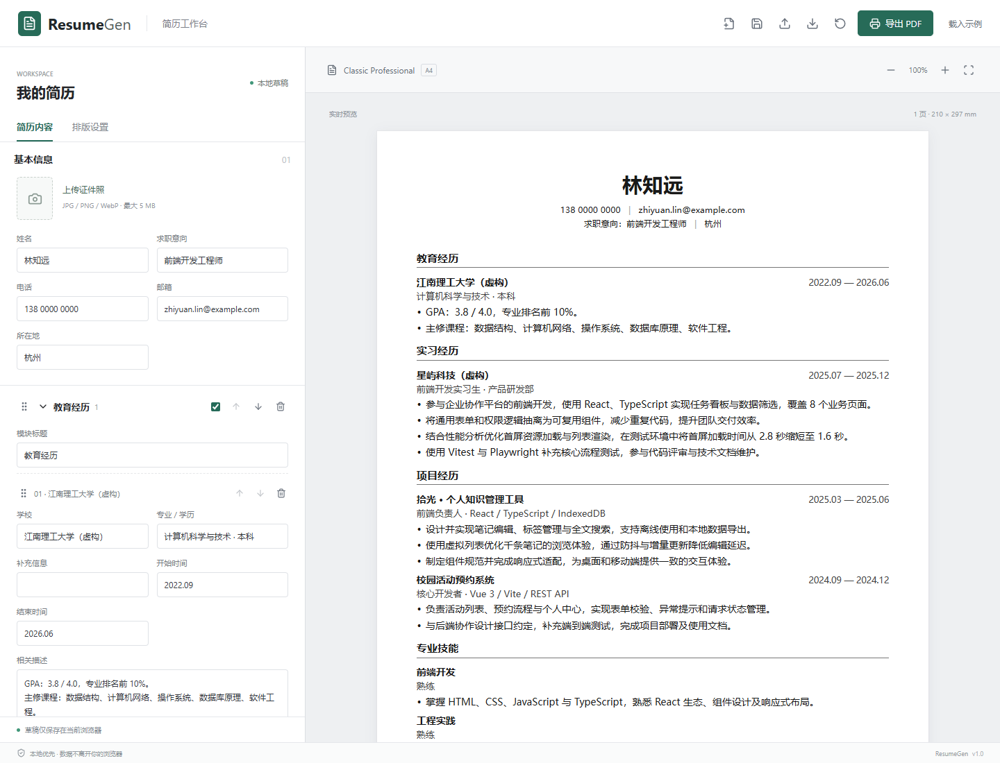
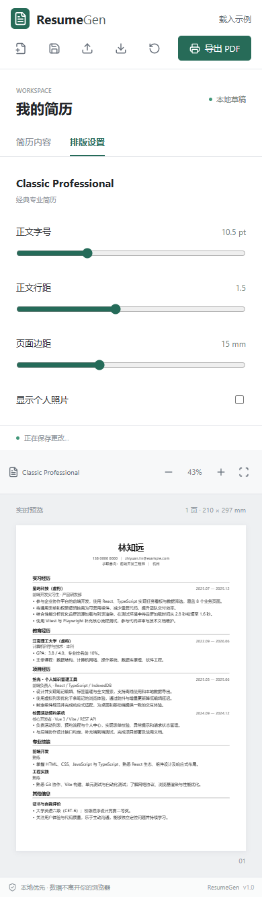

# ResumeGen

本地优先、纯前端的可视化简历生成器。填写内容、实时预览 A4 页面，使用浏览器打印导出可选择和搜索文字的 PDF。无需账户、数据库或后端。



<details>
<summary>移动端预览</summary>



</details>

## 功能

- Classic Professional 经典专业模板：居中姓名、右上证件照、紧凑模块和灰色分隔线。原始参考简历图片仅保留在本地，不随仓库分发。
- 基本信息、教育、工作经历、项目、技能、其他模块；支持多条记录、编辑、删除、显示 / 隐藏。
- 模块和记录均支持拖拽排序、键盘排序（聚焦拖动手柄，空格开始，方向键移动，空格结束）及上下移动按钮。
- 字号、行距、边距、照片显示设置；A4 多页预览、缩放和自动适应宽度。
- 自动保存当前草稿至 localStorage，手动保存，完整 JSON 导入 / 导出。
- 本地照片校验（JPEG / PNG / WebP，最大 5 MB），等比缩放，拒绝远程图片地址和 SVG。
- 按实际 DOM 高度分页，长段落拆分；标题与首段保持同页，异常溢出会提示并阻止 PDF 导出。
- 内置虚构示例。示例中的人物、学校、公司、经历与成果均不指代真实对象。

## 技术栈

React 19、TypeScript、Vite、原生 CSS、Zustand、Zod、dnd-kit、Lucide、Vitest、Playwright。数据与模板分离，后续可增加模板或使用 Tauri 封装；当前版本没有桌面应用依赖。

## 本地开发

需要 Node.js 22 或更新的受支持版本（附带 npm）。从 [Node.js 官网](https://nodejs.org/)安装后，重新打开 VS Code 或终端，运行 `node -v` 和 `npm -v` 确认版本。已有符合要求的 Node.js 时无需重新安装。

在 VS Code 中选择「文件 → 打开文件夹」，打开项目根目录（包含 `package.json` 的文件夹），再选择「终端 → 新建终端」。可以通过 Git 克隆项目：

```bash
git clone <你的仓库地址>
cd ResumeGen
npm ci
npm run dev
```

也可以在 GitHub 点击「Code → Download ZIP」，解压后用 VS Code 打开项目文件夹，在终端执行 `npm ci`，再执行 `npm run dev`。下载 ZIP 不需要安装 Git。

Windows PowerShell 若提示无法运行 `npm.ps1`，使用：

```powershell
npm.cmd ci
npm.cmd run dev
```

首次下载源码需要先安装依赖；仓库不会包含 `node_modules`。安装完成后，日常启动只需 `npm run dev`（Windows 也可用 `npm.cmd run dev`）。依赖清单或锁文件更新后，再执行 `npm ci`。没有安装 Node.js/npm 的电脑无法直接运行这些命令。

访问终端显示的本地地址，默认是 `http://127.0.0.1:5173`；端口被占用时以实际输出为准。开发期间保持终端运行，按 `Ctrl + C` 停止服务。服务也可以从其他终端或后台任务启动，因此即使没有打开 VS Code，仍可能访问到已运行的本地服务。

### 仅为当前项目使用 Node.js 22

项目不依赖特定的 Node.js 安装路径。使用 nvm 等工具管理多个版本时，可以让本项目终端使用 Node.js 22，同时保留其他项目的环境。

Windows PowerShell 可将实际的 Node.js 22 安装目录临时放到当前终端的 PATH 最前面（将下面的占位路径替换为你自己的目录，其中应包含 `node.exe` 和 `npm.cmd`）：

```powershell
$env:Path = 'C:\替换为你的Node22安装目录;' + $env:Path
node -v
npm.cmd ci
npm.cmd run dev
```

该设置仅影响当前终端及其启动的进程，不修改系统 PATH。确认 `node -v` 输出 22 或更新的受支持版本后再启动项目。

如果在 `.vscode/settings.json` 中配置了个人 Node.js 路径，它只用于本机工作区终端，不是项目的必要配置；本仓库已将该文件加入 `.gitignore`，其他人无需复制或修改你的路径。如果此前已提交该文件，需要运行 `git rm --cached .vscode/settings.json` 并提交更改，才能停止跟踪；本地文件仍会保留。

### 无需安装 Node.js 的使用方式

如果只需要填写和导出简历，可以直接访问部署后的网页，无需下载源码、安装 Node.js 或执行命令。仓库维护者可按下方「GitHub Pages」步骤部署，再分享网页地址。仅上传源码到 GitHub 不等于已经发布网页。

当前项目未提供下载后双击即可运行的桌面安装包。源码开发需要 Node.js 和依赖；部署后的静态网页只需要浏览器。

### 开发与验证命令

```bash
npm run build          # 类型检查与生产构建，输出 dist/
npm run preview        # 本地预览生产构建
npm run test           # 单元测试
npm run lint           # ESLint
npm run format:check   # 格式检查
npm run format         # 格式化
npx playwright install chromium
npm run test:e2e       # 浏览器布局与 PDF 测试
npm run test:deployment # 生产构建的仓库子路径与刷新验证
```

CI 使用 `npm ci` 和提交的 `package-lock.json` 固定依赖。Windows 已安装 Edge 时可用 PowerShell 设置 `$env:PLAYWRIGHT_CHANNEL='msedge'` 后运行端到端测试。Linux 测试环境建议安装 `fonts-noto-cjk` 以确保中文字体可用。

## 使用指南

1. 左侧编辑基本信息和各段经历，描述字段每行生成一个项目符号；右侧实时更新。
2. 点击模块标题展开 / 收起；勾选框控制显示，拖动手柄或箭头调整顺序。底部选择类型添加模块。
3. 切换「排版设置」调整字号（9–14 pt）、行距（1.2–1.9）、边距（10–24 mm）及照片。
4. 修改后约 500 毫秒自动保存；顶部保存按钮可立即保存。保存失败会显示错误，请导出 JSON 备份。
5. 导出 JSON 保存完整可编辑数据，导入时校验版本、字段、长度、重复 ID 和照片。导入会先确认覆盖当前草稿。文件最大 4 MB。
6. 「新建简历」创建空白数据；「载入示例」恢复示例，都会确认覆盖。「重置模板」仅恢复排版设置。

基本信息固定在第一页页首；其余模块支持增删、隐藏与排序。单份简历最多 20 个模块，每模块最多 60 条记录，每条描述最多 15,000 个字符，以限制异常导入。内容以纯文本渲染，不执行 HTML。

## PDF 导出

点击「导出 PDF」，阅读对话框后打开浏览器原生打印窗口：

1. 目标选择「另存为 PDF」。
2. 纸张 A4、纵向、缩放 100%，使用模板默认页边距。
3. 关闭「页眉和页脚」，启用「背景图形」。
4. 确认文件名为 `姓名_简历.pdf` 并保存。

项目使用 `@page { size: A4; margin: 0 }`，页内边距由模板控制。编辑器与打印共用分页后的真实 HTML 文本，不使用 html2canvas 或截图生成 PDF。照片保持比例，不拉伸、不裁剪。

浏览器安全机制不允许网页强制打印为 PDF、自动下载、指定保存位置，或强制关闭所有浏览器的页眉页脚。项目用 `document.title` 建议文件名，最终仍由打印窗口确认。推荐 Chrome / Edge；其他浏览器打印实现可能不同，请先检查预览。极端长标题若超过单页会提示，需缩短文字或调小字号后再导出。

字体使用本机「微软雅黑 / 苹方 / Noto Sans CJK SC」等中文字体及 Arial 回退，不从第三方 CDN 下载字体。不同系统可能出现字形和分页差异；同一浏览器下，预览和打印使用相同字体及页面结构。若系统缺少中文字体，请安装相应字体后刷新。

## 数据与隐私

应用不会上传简历，不使用统计 SDK、远程字体、远程头像或后端。localStorage 只属于当前浏览器与站点来源；清理浏览器数据、更换浏览器、隐私模式退出或变更域名可能丢失草稿。请定期导出 JSON。数据没有加密，不宜在共用设备保存敏感信息。

首次读取到损坏草稿时会显示警告并载入示例，读取操作不会覆盖原草稿；手动保存或开始修改后将写入当前内容。配额不足时仍可继续编辑和导出。

## 项目结构

```text
src/
  components/   工具栏、预览与通用按钮
  data/         虚构示例和空白数据
  editor/       表单、设置与拖拽排序
  stores/       Zustand 状态、自动保存
  templates/    独立 Classic Professional 模板
  types/        Zod 数据模型及 TypeScript 类型
  utils/        JSON、照片、排序与分页
  styles/       编辑器、模板、打印样式
tests/
  data.test.ts  数据、安全边界与分页单元测试
  e2e/          浏览器、布局、PDF 文本与纸张验证
docs/PLAN.md    阶段计划与验收标准
```

## GitHub Pages

1. 将项目推送到 GitHub 仓库的 `main` 分支。
2. 在仓库 **Settings → Pages → Build and deployment → Source** 选择 **GitHub Actions**。
3. `.github/workflows/pages.yml` 自动安装依赖、运行检查和浏览器测试、构建并部署。PR 只验证，不部署。
4. 部署完成后访问 Actions 输出的 Pages 地址，普通仓库通常为 `https://<用户名>.github.io/<仓库名>/`。

工作流自动从仓库名计算 `BASE_PATH`，兼容普通子路径和 `<用户名>.github.io` 根路径仓库。自定义域名部署时将构建环境 `BASE_PATH` 改为 `/`，并按 GitHub Pages 设置自定义域名。本项目不使用服务端路由，静态托管即可运行。

手动构建子路径示例（PowerShell）：

```powershell
$env:BASE_PATH = '/ResumeGen/'
npm run build
npm run preview
```

子路径构建的本地预览也需保留相同的 `BASE_PATH` 环境变量，访问 `/ResumeGen/`；测试脚本会自动设置构建和预览环境。

## 验证产物

Playwright 在 `test-results/` 生成桌面 / 移动端截图与示例 PDF，报告位于 `playwright-report/`。测试验证默认一页 A4、长文本多页不裁切、中文可提取、最终段落保留、图片加载、本地保存、非法导入和窄屏无页面级横向溢出。生成的 PDF 和报告默认不提交 Git。

## License

[MIT](LICENSE)
